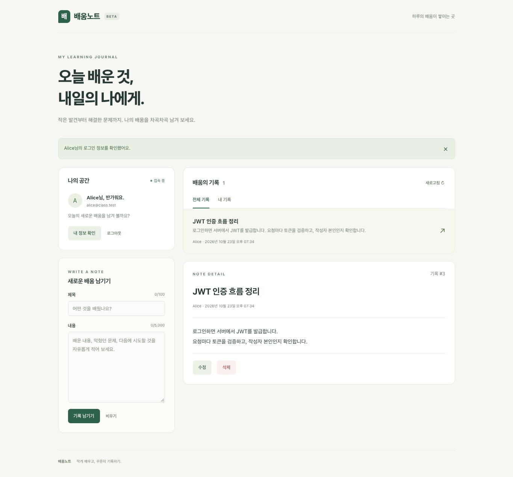
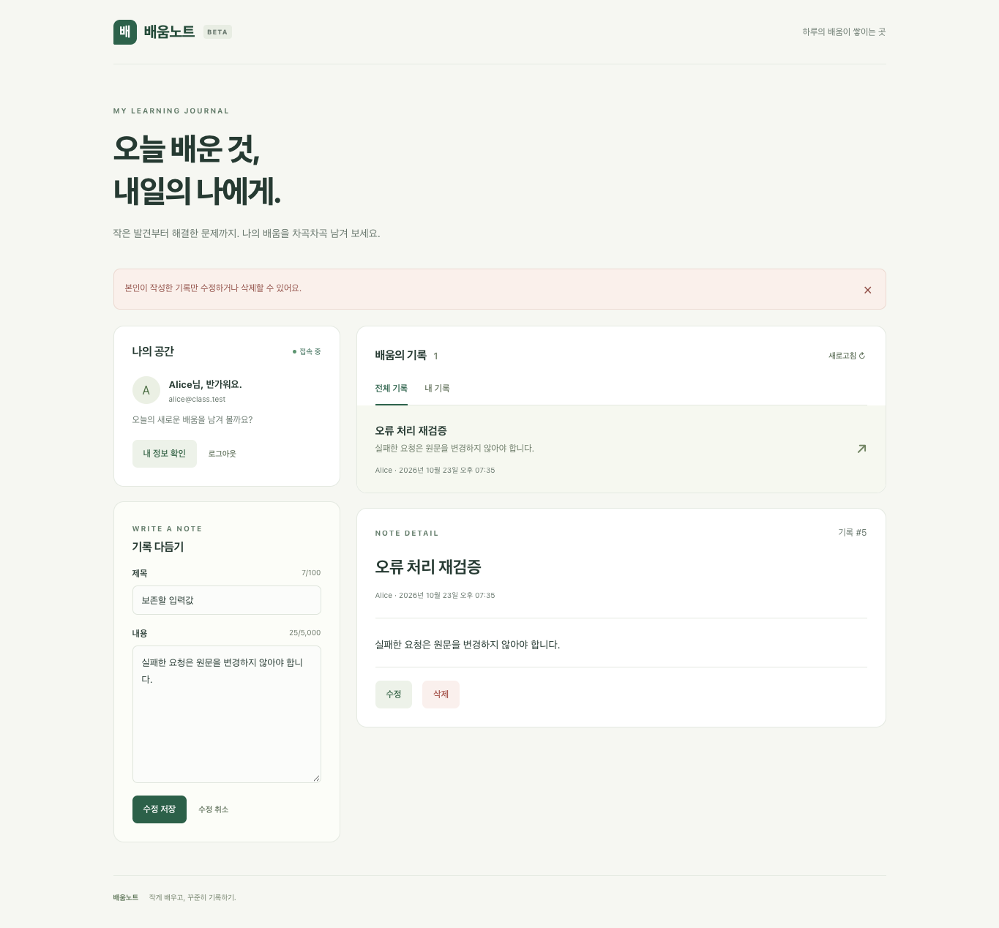
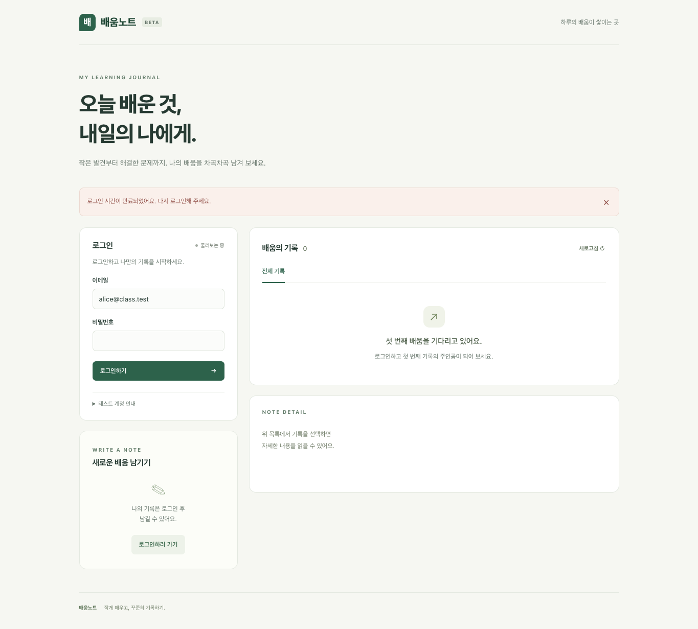

# JWT 게시판 구현 보고서

## 1 서비스 소개와 구현 범위

서비스 이름: **배움노트**

| 이름 | 학번 | 제출 예정일 |
| --- | --- | --- |
| 이주호 | 202116786 | 2026-10-28 |

저장소: https://github.com/jooho-le/WebServiceDesign_homework1 (main). 코드 기준: `c4b24fb1740ee56c18970d6a93a5755d37198473`. 최종 제출 SHA는 main의 마지막 커밋을 확인해 LMS에 함께 적는다.

### 서비스 이름·대상 사용자·목적

배움노트는 수업에서 배운 내용이나 공부하면서 해결한 문제를 기록하는 게시판이다. 공부한 내용을 정리해 두고 나중에 다시 찾아보는 용도로 사용할 수 있다. 글 목록과 상세 내용은 누구나 볼 수 있고, 글을 쓰려면 로그인해야 한다. 다른 사람의 기록을 바꾸지 못하도록 수정과 삭제는 작성자에게만 허용했다.

### 기술 조합·버전과 선택 이유

화면은 React, 서버는 FastAPI를 선택했다. React에서는 로그인 여부와 선택한 글을 상태로 관리하고, FastAPI에서는 요청을 받아 JSON으로 응답하도록 구성했다. SQLite는 별도 DB 서버를 설치할 필요가 없고 파일로 데이터가 남아, 로컬에서 실행하고 재시작 후 데이터를 확인하기에 적합하다.

| 구분 | 기술·버전 |
| --- | --- |
| 프론트 | React 19.3.0 / Vite 8.3.4 |
| 백엔드·인증 | FastAPI 0.143.0 / Uvicorn 0.54.0 / PyJWT 2.15.1 |
| 설정·데이터 | python-dotenv 1.2.4 / Python sqlite3 / SQLite 파일 DB |
| 검증 환경 | macOS / Python 3.11.9 / Node.js 20.19.5 / Chrome |

| 기능 | 완료 여부 | 관련 파일 | 비고·제한 |
| --- | --- | --- | --- |
| 공개 목록과 상세 | 구현·검증 | app.py / main.jsx | 비로그인 허용 |
| 로그인과 JWT 발급 | 구현·검증 | auth.py / api.js | 제공 계정만 허용 |
| 인증과 내 정보 조회 | 구현·검증 | auth.py / app.py | 공개 user만 반환 |
| 본인 글 작성·수정·삭제 | 구현·검증 | app.py / store.py | 서버 작성자 검사 |
| 만료·로그아웃·오류 표시 | 구현·검증 | api.js / main.jsx | 401은 세션 제거 |
| DB 데이터 유지 | 검증 완료 | store.py | 재시작 후 글 유지 |

제공된 게시판 CRUD와 계정 검증 코드를 바탕으로 JWT 인증, 로그인 화면, 작성자 권한 검사를 추가했다. 이번 구현은 제공된 두 계정을 이용한 게시판 기능에 집중했다. 회원가입, Refresh Token, 이미지 업로드와 공개 배포는 구현 범위에서 제외했다. AI 사용 범위와 코드 출처는 5절에 정리했다.

## 2 구조와 변경 내역

React 화면 / main.jsx → API 호출 / api.js → FastAPI / app.py · auth.py → SQLite / store.py

브라우저에서 /api로 보낸 요청은 Vite 프록시를 거쳐 127.0.0.1:8000의 서버로 전달된다. 빌드한 화면의 주소는 127.0.0.1:4173이다. 로그인 토큰은 api.js의 메모리에 저장한다. localStorage나 sessionStorage에는 저장하지 않으므로 새로고침하면 로그인 상태가 사라진다.

| 요청 | 입력에서 응답까지의 흐름 |
| --- | --- |
| 로그인 | 폼 → POST /api/auth/login → fields → verify_credentials → issue_token → token·user → 메모리 세션 |
| 글 수정 | PUT + Bearer → current_user_id → ID 검사 → 글 존재 → assert_owner → 입력 검사 → DB 변경 → 200 |
| 공개 조회 | GET /api/posts 또는 /{id} → 저장소 조회 → JSON. 인증 없이 허용 |

### 변경 파일·원래 역할·변경 내용·이유·출처

| 파일·함수 | 제공 코드의 원래 역할 | 변경 내용 | 이유·출처 |
| --- | --- | --- | --- |
| backend/auth.py<br>issue_token / current_user_id / assert_owner | 501 발급, ID=1 반환, 빈 권한 검사 | HS256 발급·검증, 실제 계정과 작성자 비교 | 인증·권한 완성<br>AI 생성 반영 |
| backend/config.py<br>load_secret | 별도 설정 검사 없음 | .env 로드, 키·TTL·발급자·대상 검사 | 잘못된 설정 조기 거부<br>AI 추가 |
| backend/app.py<br>login / fields / post_id | 라우트·입력·응답 제공 | TTL 연결, 원문 비밀번호 길이·긴 ID·깨진 문자 검사 | 명세·400 처리 준수<br>제공 + AI 수정 |
| backend/store.py | SQLite CRUD·파일 저장 | 상대 경로를 backend 기준으로 고정 | 실행 위치와 DB 분리 방지<br>제공 + AI 수정 |
| backend/users.py | 계정·scrypt 검증 | 기존 함수를 유지 | 제공 검증 유지<br>제공 코드 |
| frontend/src/api.js | 로그인·헤더·canEdit 미완성 | 메모리 세션·Bearer·오류·작성자 비교 | 화면과 인증 연결<br>AI 작성 반영 |
| frontend/src/main.jsx / style.css / index.html | 기본 게시판·데모 화면 | 학습 기록 주제·본인 버튼·오류·반응형 | 최종 서비스 화면<br>제공 구조 + AI |
| tools/check_api.py | 공통 API 검사 제공 | 수정 없이 사용 | 제공 계약 검증<br>제공 코드 |
| tools/setup_env.py / check_security.py / check_frontend.mjs | 별도 보조 도구 없음 | 키 생성·추가 보안·프론트 검사 | 재현·검증 보완<br>AI 추가 |
| README.md / docs/report.md / docs/report.pdf / docs/AI_USAGE.md | 실행 안내·보고서 양식 제공 | 선택 조합의 실행 방법·구현·검증·출처 기록 | 실행·제출 문서 작성<br>AI 작성 반영 |

선택한 기술에 맞춰 frontend-react와 backend-fastapi를 frontend와 backend로 바꿨다. 사용하지 않는 Vue, Express, Spring 폴더는 제거했다. 실행할 폴더를 쉽게 구분하기 위해서이며, 제공된 과제 문서는 그대로 남겼다.

DB 파일은 backend/data/board.sqlite에 자동으로 생성된다. 터미널의 실행 위치가 달라도 같은 DB를 사용하도록 backend 폴더를 기준으로 경로를 정했다. 글을 수정해도 작성자와 작성 시각은 바뀌지 않는다. DB를 초기화하려면 서버를 종료한 뒤 이 파일을 삭제하면 된다.

## 3 핵심 코드 설명

### 3.1 로그인과 JWT 발급

관련 함수: `backend/app.py:71 login`, `backend/users.py: verify_credentials`, `backend/auth.py:11 issue_token`.

**backend/app.py · 70–80행**

```python
@app.post("/api/auth/login")
async def login(request: Request):
    data = await fields(request, dict(email=254, password=128))
    user = verify_credentials(**data)
    if not user:
        raise ApiError(401, "INVALID_CREDENTIALS", "이메일 또는 비밀번호를 확인하세요.")
    return dict(
        accessToken=issue_token(user),
        expiresIn=TOKEN_TTL,
        user=user,
    )
```

로그인 폼에서 받은 email과 password를 JSON으로 보낸다. 서버의 fields 함수에서 입력 형식과 길이를 검사한 뒤, 제공된 verify_credentials 함수로 계정과 비밀번호를 확인한다. 이 함수는 scrypt 해시와 상수 시간 비교를 사용한다. 계정이 없거나 비밀번호가 틀리면 401 INVALID_CREDENTIALS를 반환하고 토큰은 발급하지 않는다.

**backend/auth.py · 11–22행**

```python
def issue_token(user):
    """비밀번호 검증을 마친 계정의 공개 정보로 JWT를 발급합니다."""
    return jwt.encode(
        {
            "sub": str(user["id"]),
            "exp": int(time.time()) + TOKEN_TTL,
            "iss": JWT_ISSUER,
            "aud": JWT_AUDIENCE,
        },
        JWT_SECRET,
        algorithm="HS256",
    )
```

계정 확인이 끝나면 사용자 ID를 문자열로 바꿔 sub에 넣고, 현재 시각에 유효 시간을 더해 exp를 정한다. iss와 aud도 함께 넣어 HS256으로 서명한다. 토큰에는 비밀번호나 비밀번호 해시를 담지 않는다. 로그인 성공 시에는 200 응답으로 accessToken, expiresIn과 사용자 정보(id, name, email)를 반환한다.

| 설정 | 실제 구현 |
| --- | --- |
| 서버 키 | secrets.token_hex(32)로 생성. load_secret이 64자리 hex 검사 후 bytes.fromhex로 32바이트 변환 |
| 잘못된 키 | 빈 값·형식 오류·예시 자리표시자·한 문자 반복 키는 시작 시 거부 |
| 발급자 / 사용 대상 | JWT_ISSUER=webservice-class / JWT_AUDIENCE=board-api |
| 유효 시간 | TOKEN_TTL 기본 90초. 실제 만료 검사에는 프로세스 환경변수 3초 사용 |

### 실패 응답과 검증 근거

입력 오류는 400 BAD_INPUT, 계정·비밀번호 불일치는 401 INVALID_CREDENTIALS다. 잘못된 키·TTL은 서버 시작 단계에서 거부한다.

근거: recheck-api-final.txt의 정상·실패 로그인, recheck-security.txt의 발급 클레임·잘못된 설정 검사.

### 3.2 브라우저 토큰 저장과 전송

관련 함수: `frontend/src/api.js:65 login`, `authorizationHeaders`, `request`, `clearSession`; 화면 연결: `frontend/src/main.jsx`.

**frontend/src/api.js · 65–75행**

```javascript
export async function login(email, password) {
  const data = await request("/auth/login", {
    method: "POST",
    body: JSON.stringify({ email, password }),
  });
  setSession({ accessToken: data.accessToken, user: data.user });
  return data.user;
}
export function canEdit(post) {
  return Boolean(session.user && post && session.user.id === post.authorId);
}
```

로그인에 성공하면 응답의 토큰과 사용자 정보를 session에 저장한다. 세션이 바뀌면 React 화면도 갱신되어 사용자 이름이 표시된다. canEdit 함수는 로그인한 사용자의 ID와 글의 authorId를 비교한다. 두 값이 같을 때만 수정과 삭제 버튼을 보여 준다.

**frontend/src/api.js · 13–20행**

```javascript
export function clearSession() {
  setSession({ accessToken: "", user: null });
}
function authorizationHeaders() {
  return session.accessToken
    ? { Authorization: `Bearer ${session.accessToken}` }
    : {};
}
```

request 함수는 authorizationHeaders의 결과를 요청 헤더에 합친다. 따라서 로그인한 상태에서 /me 조회나 글 작성·수정·삭제를 요청하면 Bearer 토큰이 함께 전송된다. 토큰이 없으면 Authorization 헤더를 넣지 않는다. 목록과 상세 조회는 로그인하지 않아도 사용할 수 있다.

| 응답·상태 | 화면과 세션 처리 |
| --- | --- |
| 200 / 201 | 반환된 글·사용자 정보로 목록과 상세 상태 갱신 |
| 204 | response.json을 호출하지 않고 삭제한 글·선택 상태 갱신 |
| 400 BAD_INPUT | 입력 안내. 작성 중인 값과 로그인 유지 |
| 401 계열 | 토큰·사용자 제거, 편집 상태 해제, code별 재로그인 안내 |
| 403 FORBIDDEN | 권한 부족 안내. 로그인과 입력 유지 |
| 404 NOT_FOUND | 선택 글 해제와 목록 재조회 |
| 연결 실패 / 비JSON 응답 | 서버 연결·응답 오류 안내. 성공 알림을 표시하지 않음 |

로그아웃·새로고침은 메모리 세션을 지우지만 글은 DB에 남는다. 브라우저 검사에서 localStorage·sessionStorage 항목 수는 모두 0이었다.

근거: recheck-frontend-build.txt(401·403 모듈 검사), recheck-browser-ui.txt·recheck-browser-errors.txt(화면·헤더 검사).

### 3.3 서버 JWT 검증

관련 함수: `backend/auth.py:25 current_user_id`. 보호 대상은 GET /api/me 및 게시글 POST·PUT·DELETE다.

**backend/auth.py · 25–41행**

```python
def current_user_id(request):
    header = request.headers.get("Authorization", "")
    match = re.fullmatch(r"Bearer[ \t]+([^\s]+)", header, flags=re.IGNORECASE)
    if not match:
        raise ApiError(401, "TOKEN_REQUIRED", "로그인이 필요합니다.")
    token = match.group(1)
    options = {"require": ["sub", "exp", "iss", "aud"], "strict_aud": True}
    try:
        # 만료 전에 나머지 클레임도 확인해, 잘못된 토큰을 만료로 오인하지 않습니다.
        claims = jwt.decode(
            token,
            JWT_SECRET,
            algorithms=["HS256"],
            issuer=JWT_ISSUER,
            audience=JWT_AUDIENCE,
            options={**options, "verify_exp": False},
        )
```

서버는 Authorization 헤더에서 Bearer 뒤의 토큰을 읽는다. 헤더가 없거나 Bearer 형식이 맞지 않으면 401 TOKEN_REQUIRED를 반환한다. 토큰 값이 JWT가 아니거나 서명이 틀리면 401 INVALID_TOKEN으로 처리한다. 검증에 사용할 알고리즘은 HS256으로 고정해, 토큰에 적힌 알고리즘을 그대로 믿지 않도록 했다.

### 클레임과 실제 사용자 확인

첫 번째 jwt.decode에서는 **서명을 검증하면서** 만료 시각 판정만 뒤로 미룬다. sub, exp, iss, aud가 있는지와 발급자·사용 대상이 맞는지 먼저 검사한다. 이어서 sub가 양의 정수 문자열인지, 실제로 존재하는 계정인지, exp가 정수인지 확인한다. 이 조건을 통과한 토큰에 대해 두 번째 jwt.decode로 만료 여부를 검사한다.

**backend/auth.py · 59–67행**

```python
except jwt.ExpiredSignatureError:
    raise ApiError(
        401, "TOKEN_EXPIRED", "로그인 시간이 만료되었습니다. 다시 로그인하세요."
    ) from None
except jwt.InvalidTokenError:
    raise ApiError(
        401, "INVALID_TOKEN", "로그인 정보를 확인할 수 없습니다. 다시 로그인하세요."
    ) from None
return int(subject)
```

정상적인 토큰의 유효 시간만 지난 경우에는 401 TOKEN_EXPIRED를 반환한다. 서명이나 클레임, 사용자 정보가 잘못된 경우에는 INVALID_TOKEN을 반환한다. 다른 항목부터 검사하므로 audience가 틀리고 exp도 지난 토큰은 단순 만료가 아닌 잘못된 토큰으로 처리된다.

### 검증 결과를 사용하는 위치

검증을 통과하면 current_user_id가 사용자 ID를 반환한다. /me는 이 ID로 계정의 공개 정보만 조회하고, 글을 등록할 때도 이 ID를 작성자로 저장한다. 요청 본문의 사용자 ID나 서명을 확인하지 않은 payload는 사용하지 않는다. 오류가 발생하면 ApiError 처리기가 HTTP 상태와 code, message를 반환한다. 보호 API의 401 응답에는 WWW-Authenticate: Bearer도 포함한다.

PyJWT의 decode 함수는 기본적으로 서명을 검증한다. JWT 내용을 읽기만 하는 방식과는 다르며, 이 코드에서는 verify_signature=False 옵션을 사용하지 않았다. 추가 보안 검사에서도 다른 알고리즘, 서명 없는 토큰, 클레임 누락이나 잘못된 타입, 없는 사용자 계정이 거부되는 것을 확인했다.

### 3.4 작성자 권한 검사

관련 함수: `backend/app.py:102 create`, `update`, `delete`; `backend/auth.py:70 assert_owner`; `backend/app.py:22 fields`.

**backend/app.py · 111–117행**

```python
@app.put("/api/posts/{id}")
async def update(id: str, request: Request):
    user_id = current_user_id(request)
    pid = post_id(id)
    post = existing(pid)
    assert_owner(user_id, post["authorId"])
    return store.update_post(pid, await fields(request, dict(title=100, content=5000)))
```

**backend/auth.py · 70–72행**

```python
def assert_owner(user_id, author_id):
    if user_id != author_id:
        raise ApiError(403, "FORBIDDEN", "본인이 작성한 글만 수정·삭제할 수 있습니다.")
```

글을 등록할 때 작성자는 current_user_id의 결과로 정한다. 수정과 삭제에서는 DB에 저장된 authorId와 로그인한 사용자의 ID를 비교하고, 다르면 DB를 바꾸기 전에 403 FORBIDDEN을 반환한다. 화면에서 버튼을 숨겨도 직접 API를 호출할 수 있으므로 서버의 권한 검사가 필요하다.

인증 → 글 존재 확인 → 작성자 비교 → 입력 검사 → DB 변경

| 조건 | 처리 기준 |
| --- | --- |
| 제목·내용 | 각각 문자열 필수, 앞뒤 공백 정리 후 제목 1~100자·내용 1~5000자. 공백만 있는 입력 거부 |
| 허용 JSON 필드 | 등록·수정은 title·content만 허용. authorId·userId·id 등은 400 BAD_INPUT |
| 문자·ID | UTF-8로 표현 불가능한 단독 surrogate 거부. ID는 범위 내 양의 정수 문자열만 허용 |
| 생성·수정·삭제 | 등록은 201 + Location. 수정은 200, 작성자·createdAt 유지. 삭제는 204 + 빈 본문 |

### 여러 오류가 겹친 요청의 실제 결과

| 실제 요청 조건 | 반환 HTTP / code | DB 결과 |
| --- | --- | --- |
| 토큰 없이 없는 글 수정 | 401 / TOKEN_REQUIRED | 변경 없음 |
| 정상 토큰으로 없는 글 수정 | 404 / NOT_FOUND | 변경 없음 |
| Bob이 Alice 글에 공백 제목 전송 | 403 / FORBIDDEN | 원문 유지 |
| Alice가 자기 글에 공백 제목 전송 | 400 / BAD_INPUT | 원문 유지 |
| 만료 토큰으로 변경 요청 | 401 / TOKEN_EXPIRED | 원문 유지 |

400이나 403 응답을 받은 뒤 상세 조회를 다시 요청했을 때 원래 글이 유지되었다. 위 순서는 ID와 JSON 형식이 정상인 경우를 기준으로 한다. ID 형식 오류는 400이며, 본인 글에 대한 요청의 JSON 형식 오류도 400으로 처리한다.

근거: recheck-api-expiry.txt, recheck-security.txt의 권한 순서·헤더·빈 본문 검사, recheck-browser-errors.txt.

## 4 테스트 결과와 증거

테스트 환경은 macOS, Python 3.11.9, Node.js 20.19.5, Chrome과 Playwright 1.64.1이다. 10월 23일 기본 검사를 진행했고 10월 28일 새 로컬 Git clone에서 설치, API·화면과 기본 DB 재시작을 다시 확인했다. Codex로 실행한 자동 검사 결과이며, 별도 수동 테스트는 포함하지 않았다.

검증한 코드와 현재 코드의 SHA-256은 일치한다. 기존 해시는 recheck-manifest.json에, 새 설치·실행 결과는 runtime-20261028.txt에 남겼다. GitHub main을 새 폴더에 clone해 설치·API·화면·기본 DB 재시작도 확인했다.

**설치·실행: Python 3.11 사용. 첫 3줄은 루트, 서버는 backend, npm은 frontend의 별도 터미널**

```sh
python3 -m venv backend/.venv
backend/.venv/bin/python -m pip install -r backend/requirements.lock
python3 tools/setup_env.py
.venv/bin/python -m uvicorn app:app --host 127.0.0.1 --port 8000
npm ci
npm run build
npm run preview
```

새 clone에는 키·DB·설치 폴더를 복사하지 않았다. setup_env.py로 키를 만들고 기본 backend/data/board.sqlite가 생성되는 것을 확인했다. 화면은 http://127.0.0.1:4173, API는 8000번이다. 설치·빌드·재시작 결과는 runtime-20261028.txt에 남겼다. 종료는 각 터미널의 Ctrl+C다.

| 확인 항목·요청 | 기대 | 실제 HTTP / code·헤더 | 증거 |
| --- | --- | --- | --- |
| GET 목록·상세·/me, POST 로그인, PUT 본인 글 | 200 | 200 / 해당 없음 | E02·09·11·14·32 |
| POST /api/posts | 201 + Location | 201 / Location: /api/posts/1 | E13 |
| DELETE 본인 글 | 204 + 빈 본문 | 204 / body_bytes=0 | E45·47 |
| 입력·추가 작성자 필드 | 400 BAD_INPUT | 400 / BAD_INPUT | E21–26 |
| 틀린 계정·비밀번호 | 401 INVALID_CREDENTIALS | 401 / INVALID_CREDENTIALS | E05·06 |
| 토큰 없음·Bearer 형식 | 401 TOKEN_REQUIRED | 401 / TOKEN_REQUIRED; Bearer | E07·08; S02 |
| 변조·클레임 오류 | 401 INVALID_TOKEN | 401 / INVALID_TOKEN; Bearer | E27–30; S04·09 |
| 실제 만료 토큰 | 401 TOKEN_EXPIRED | 401 / TOKEN_EXPIRED; Bearer | E38–41 |
| Bob의 Alice 글 변경 | 403 FORBIDDEN | 403 / FORBIDDEN | E16·19 |
| 없는 글·잘못된 ID | 404 / 400 | 404 / NOT_FOUND; 400 / BAD_INPUT | E03·04·35·36 |

E01~E48의 요청과 응답은 docs/evidence/report-api-20261028.md와 JSON 파일에 있다. Sxx는 recheck-security.txt의 test_xx다. 표의 Bearer는 WWW-Authenticate 값이다. 기본 TTL은 90초, 만료 검사는 3초로 설정해 4초 후 요청했다. API 48개·보안 10개·프론트 10개·Chrome 17개 검사를 통과했다.

**검사 명령: 두 번째는 TOKEN_TTL=3 서버, 세 번째는 자체 임시 서버 사용**

```sh
backend/.venv/bin/python tools/check_api.py --mode final
backend/.venv/bin/python tools/check_api.py --mode final --expiry
backend/.venv/bin/python tools/check_security.py
```

위 명령으로 API와 추가 보안 검사를 실행할 수 있다. 프론트 검사는 frontend 폴더에서 npm test로 실행한다. 화면 캡처와 요청별 기록은 docs/evidence에 첨부했다.

### 4.1 테스트 시나리오 T01–T17

표에서는 P를 /api/posts, M을 /api/me, L을 /api/auth/login의 약자로 사용했다. 예상 결과와 자동 검사에서 받은 실제 응답을 나눠 적었다. 각 E번호에 해당하는 요청 본문, 응답과 헤더는 별도 증거 파일에서 확인할 수 있다.

| ID | 수행 절차·사용자 | 예상 결과 | 실제 HTTP / code | 판정 | 증거 |
| --- | --- | --- | --- | --- | --- |
| T01 | 무토큰 GET P·P/1 | 200 | 200 / 해당 없음 | PASS | E02·14/U |
| T02 | Alice POST L | 200 + JWT·user | 200 / 해당 없음 | PASS | E09/U |
| T03 | 틀린 비밀번호·없는 계정 POST L | 401 INVALID_CREDENTIALS | 401 / INVALID_CREDENTIALS | PASS | E05·06 |
| T04 | 무토큰 GET M·POST P | 401 TOKEN_REQUIRED | 401 / TOKEN_REQUIRED | PASS | E07·08 |
| T05 | Alice POST P·GET M | 201·200, 작성자=1 | 201·200 / 해당 없음 | PASS | E11·13 |
| T06 | Alice PUT·DELETE P/1 | 200·204 | 200·204 / 해당 없음 | PASS | E32·45/U |
| T07 | Bob PUT P/1(Alice 글) | 403 FORBIDDEN | 403 / FORBIDDEN | PASS | E16·17/B |
| T08 | Bob DELETE P/1(Alice 글) | 403 FORBIDDEN | 403 / FORBIDDEN | PASS | E19·20 |
| T09 | 서명 변조: GET M, POST·PUT·DELETE P | 401 INVALID_TOKEN | 401 / INVALID_TOKEN | PASS | E27–31 |
| T10 | TTL=3 실제 만료: GET M·글 변경 | 401 TOKEN_EXPIRED | 401 / TOKEN_EXPIRED | PASS | E38–42/E |
| T11 | 로그아웃 후 무토큰 GET M | 401 TOKEN_REQUIRED | 401 / TOKEN_REQUIRED | PASS | B·H |
| T12 | Bob POST P에 authorId·userId 추가 | 400 BAD_INPUT | 400 / BAD_INPUT | PASS | E21·22 |
| T13 | Alice POST P: 공백·길이 초과 | 400 BAD_INPUT | 400 / BAD_INPUT | PASS | E23–26/S·B |
| T14 | GET·정상 토큰 PUT·DELETE 없는 P/id; GET P/abc | 404 NOT_FOUND / 400 BAD_INPUT | 404 / NOT_FOUND; 400 / BAD_INPUT | PASS | E03·04·35·36 |
| T15 | 글 생성 후 서버 종료·재실행·GET | 데이터 전체 유지 | 200 / 전체 객체 일치 | PASS | P·S07 |
| T16 | 로그인 후 페이지 새로고침 | 글 유지·세션 해제 | 200 / 글 유지, 세션 없음 | PASS | U |
| T17 | 무토큰 PUT·DELETE P/1; Bob 본인 CRUD | 401 / 본인 201·200·204 | 401 TOKEN_REQUIRED; 201·200·204 | PASS | E15·18·33·34·47 |

E번호: report-api-20261028.md·json. S=recheck-security.txt, U=recheck-browser-ui.txt, B=recheck-browser-errors.txt, E=recheck-browser-expiry.txt, H=recheck-http.json, P=recheck-persistence.txt. 모두 docs/evidence 아래에 있다. 10월 28일 새 clone 재검증은 runtime-20261028.txt에 기록했다.

| 화면·데이터 확인 | 실제 관찰 결과 |
| --- | --- |
| T02·T06·T11·T16 | 사용자 이름·본인 버튼 표시, 204 후 목록 갱신, 로그아웃·새로고침 시 세션과 버튼 해제 |
| T07~T10·T13 | 거부 후 공개 재조회 원문 유지. 400·403은 입력·로그인 유지, 401은 사용자·편집 상태 해제 |
| 복합 조건 | 무토큰으로 없는 글 수정 401, 정상 토큰이면 404. Bob의 공백 제목 403, Alice의 같은 입력 400(S05) |

일반 등록·수정 본문은 title·content 두 필드다. T12는 authorId·userId를 각각 추가했고 T13은 공백 제목·공백 본문·제목 101자·내용 5001자를 각각 전송했다. T09는 서명 첫 문자를 바꾸었고 T10은 exp를 조작하지 않고 실제 기다렸다. 그림 1~3은 6절 뒤의 화면 증거에 수록했다.

## 5 AI 활용과 참고 자료

JWT 인증과 예외 처리를 구현하는 과정에서 Codex를 사용했다. 코드 초안 작성과 오류 수정, 자동 테스트, 보고서 정리에 도움을 받았다. 아래에는 인증 구현과 오류 수정에 활용한 두 가지 사례를 정리했다.

### 사례 1. JWT 인증과 작성자 권한 구현

| 항목 | 내용 |
| --- | --- |
| 도구 / 날짜 | Codex(세부 모델 미확인) / 2026-10-23 |
| 요청 내용 요약 | React와 FastAPI로 게시판을 구성하고 로그인, JWT 인증, 작성자 권한 검사를 연결해 달라고 요청했다. |
| 제안 내용 | HS256 토큰에 sub, exp, iss, aud를 넣고, 보호 API에서 검증한 사용자 ID를 사용한다. 화면에서는 토큰을 메모리에 저장하고 Bearer 헤더로 전송한다. |
| 반영 위치 | auth.py의 issue_token, current_user_id, assert_owner / config.py / api.js의 login, request, canEdit / main.jsx |
| 반영 방식과 판단 근거 | AI가 생성한 코드를 반영했다. 계정과 비밀번호 확인은 제공된 verify_credentials를 유지했다. 토큰의 필수 클레임과 401·403 처리는 API 및 보안 검사 결과를 기준으로 확인했다. |
| 검증 결과 | 정상 로그인과 본인 글 변경은 성공했고, 무토큰·변조 요청은 401, 타인의 글 변경은 403을 반환했다. recheck-api-final.txt, recheck-security.txt, recheck-browser-ui.txt 참고. |

### 사례 2. 입력 오류와 서버 응답 처리 보완

| 항목 | 내용 |
| --- | --- |
| 도구 / 날짜 | Codex(세부 모델 미확인) / 2026-10-23 |
| 요청 내용 요약 | 제출 전에 인증, 권한, 입력 검사를 다시 점검하고 오류가 있으면 수정해 달라고 요청했다. |
| 발견한 문제 | 깨진 유니코드 문자열이 해싱이나 DB 저장 단계에서 500 오류를 일으켰다. 서버가 JSON이 아닌 응답을 보내면 화면에 적절한 안내도 나오지 않았다. |
| 반영 위치 | app.py의 fields / api.js의 request / check_security.py / check_frontend.mjs |
| 반영 방식과 판단 근거 | AI 수정안을 반영해 UTF-8로 변환할 수 없는 입력을 400으로 거부하도록 했다. 비JSON 응답에는 서버 응답을 읽을 수 없다는 안내를 표시하고, 같은 오류를 다시 검사하는 항목을 추가했다. |
| 검증 결과 | 로그인·제목·내용의 깨진 입력이 400으로 처리되고 기존 데이터는 유지되었다. 보안 10개와 프론트 10개 시나리오가 통과했다. recheck-security.txt, recheck-frontend-build.txt 참고. |

수업에서 제공한 코드에 AI가 생성한 인증·화면 코드를 반영했으며, 별도로 직접 수정한 부분은 없다. 이 밖에 10월 28일 보고서 작성과 양식 검토, API 48개 재검사에도 사용했다. 파일별 활용 범위는 AI_USAGE.md에 정리했다.

### 참고 자료

| 자료·URL | 사용 위치와 내용 |
| --- | --- |
| 교수님 JWT-Assignment: docs/01~07, 시작 코드 | 게시판 CRUD, scrypt 계정 검증, 공통 API, 보고서 양식과 검사 도구 |
| https://pyjwt.readthedocs.io/en/stable/api.html | auth.py의 HS256 발급, decode 검증 옵션과 예외 처리 |
| https://fastapi.tiangolo.com/tutorial/handling-errors/ | app.py의 ApiError 처리와 JSON 오류 응답 |

## 6 이해도 확인과 회고

#### ① 요청 본문의 authorId를 믿으면 어떤 문제가 생기는가?

요청을 보내는 사람이 authorId를 마음대로 바꾸면 다른 사람 이름으로 글을 쓸 수 있다. 그래서 fields에서 authorId 같은 추가 필드를 400으로 거부하고, 작성자는 토큰을 검증한 current_user_id의 결과로만 정한다.

#### ② 버튼 숨김만으로 충분하지 않은 이유와 검사 함수는?

버튼이 보이지 않아도 요청을 직접 만들어 보낼 수 있기 때문이다. update와 delete에서 호출하는 assert_owner가 DB의 authorId와 현재 사용자 ID를 비교한다. 로그인에 성공했더라도 다른 사람의 글이라면 수정하거나 삭제할 수 없다.

#### ③ JWT decode와 verify의 차이와 실제 검증은?

JWT 내용을 읽는 것만으로는 누가 발급했는지나 중간에 바뀌었는지 알 수 없다. 이 코드에서는 jwt.decode에 서버 키와 HS256, 발급자, 사용 대상을 지정해 검증한다. 필수 클레임과 만료 시간뿐 아니라 sub에 해당하는 계정이 실제로 있는지도 확인한다.

#### ④ 로그아웃·만료·새로고침과 복사된 토큰은?

로그아웃과 새로고침은 브라우저 메모리에 있는 토큰과 사용자 정보를 지운다. 토큰이 만료되면 서버가 401을 반환하고 화면도 로그아웃 상태로 바뀐다. 다만 로그아웃 전에 복사한 토큰은 서버에서 별도로 폐기하지 않으므로 만료 전까지 사용할 수 있다.

#### ⑤ 확인된 오류와 원인·수정·재검증 과정은?

자동 검사 중 깨진 유니코드 문자열이 비밀번호 해싱이나 DB 저장 단계에서 500 오류를 일으키는 문제가 발견되었다. fields에서 UTF-8로 변환할 수 있는지 먼저 검사하고, 변환할 수 없으면 400 BAD_INPUT을 반환하도록 수정했다. 같은 입력을 로그인과 글 작성에 다시 보내 400으로 처리되고 DB가 바뀌지 않는 것을 확인했다.

현재 자동 검사에서 발견된 필수 기능 오류는 없다. 공개 저장소 업로드와 원격 clone의 설치·실행을 확인했으며, 수동 테스트와 LMS 제출은 남아 있다. 기능을 더 보완한다면 페이지 분할과 중복 요청 방지를 추가할 수 있다.

| 제출 확인 항목 | 상태 | GitHub 확인 항목 | 상태 |
| --- | --- | --- | --- |
| 코드 설명·출처 기록 / 키·토큰 제외 | 완료 | README / 공개 문서 접근 | 완료 |
| 수동 테스트 | 미실시 | PDF·증거 업로드 / 원격 clone 실행 | 완료 |
| API·브라우저 자동 검사 | 완료 | 저장소 URL·코드 기준 / LMS 제출 | 기재 / 제출 전 |

### 화면 증거 · 4절 테스트 표와 함께 대조







캡처는 빌드한 화면에서 촬영했다. 그림 2는 수정 요청의 토큰을 Bob의 것으로 바꿔 서버의 403 응답을 확인한 장면이다. 요청 변경은 테스트에만 적용했다. HTTP 기록은 recheck-http.json과 recheck-browser-expiry.txt에 있으며, 토큰은 가렸다.

